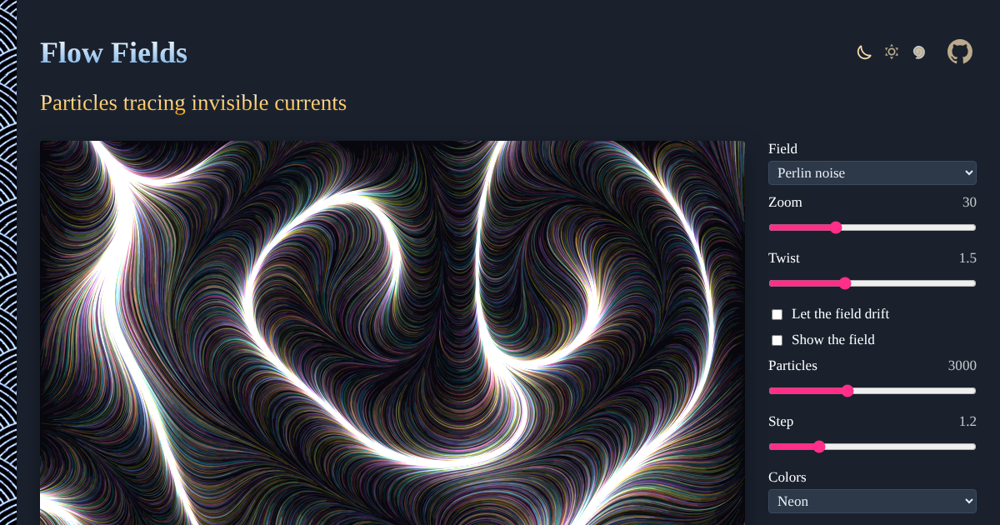

# Flow Fields

Thousands of particles follow an invisible field of arrows, from Perlin noise, curl noise or simple formulas, and draw it with thin translucent lines, like ink in water. No sign-up and no libraries.

- [Draw a flow field](https://evoluteur.github.io/flow-fields/)

## What it does

- **Field**: Perlin noise, curl noise, vortices, spiral, waves, or a grid of snapped angles.
- **Zoom** and **Twist** shape the field; **Let the field drift** moves through time in the noise; **Show the field** draws its arrows.
- **Particles** (200 to 8,000), **Step** length, **Ink** opacity and **Line width**.
- Six palettes (ink on paper, neon, ocean, sunset, forest, silver on black), colored by particle, direction or position.
- Drag on the canvas to pour particles where you want them.
- **Pause** (or the space bar), **New field**, **Clear**, and **Download PNG**.
- The address of the page keeps the settings and the seed, to share a drawing.

## How it works

Each particle takes a small step along the angle of the field at its position, and the step is drawn as a line with low opacity, blended additively on dark palettes and multiplied on paper. The noise is Ken Perlin's improved noise (2002), and curl noise is its rotated gradient (Bridson, 2007).

## Run it locally

No build and no dependencies: open `index.html` in a browser.

## Related projects

- [Voronoi Maker](https://evoluteur.github.io/voronoi-maker/)
- [Strange Attractors](https://evoluteur.github.io/strange-attractors/)
- [Reaction-Diffusion](https://evoluteur.github.io/reaction-diffusion/)

## License

Copyright (c) 2026 [Olivier Giulieri](https://evoluteur.github.io/).

Flow Fields is released under the [MIT license](https://github.com/evoluteur/flow-fields/blob/main/LICENSE).
